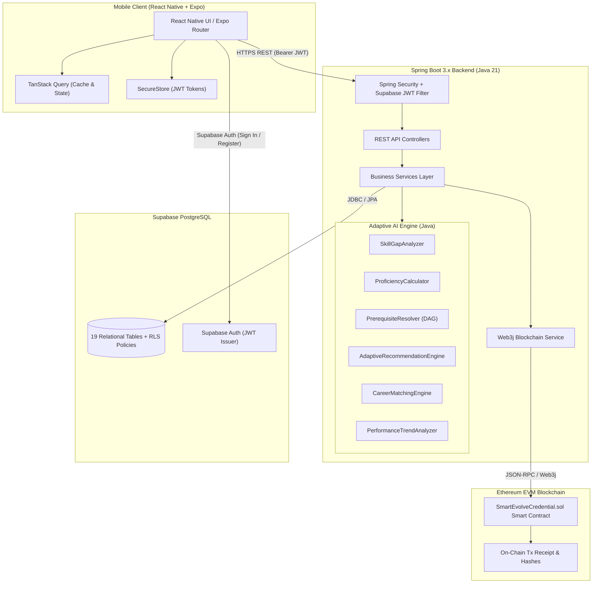

# SmartEvolve AI — System Architecture Specification

## 1. Executive Overview

SmartEvolve AI is an enterprise-grade, mobile-first, blockchain-enabled self-evolving AI system engineered for personalized student learning and career guidance. It combines:
- **Mobile-First Client**: React Native with Expo and TypeScript, Expo Router navigation, TanStack Query, and React Native SVG.
- **Microservice Backend**: Java 21, Spring Boot 3.3.4, Spring Security, Web3j, and OpenAPI 3.
- **Modular Adaptive AI Engine**: Java-based skill gap analysis, weighted proficiency calculations, prerequisite-aware topological graph roadmap generation, and performance trend analysis.
- **Database & Authentication**: Supabase PostgreSQL with 19 normalized relational tables, cryptographic indexes, and Row Level Security (RLS).
- **Blockchain Layer**: Ethereum EVM-compatible Solidity smart contract (`SmartEvolveCredential.sol`) for immutable, tamper-evident academic achievement verification without storing personally identifiable information (PII) on-chain.

---

## 2. Architecture Diagram

---

## 3. Data Flow & Adaptive Evolution Lifecycle

1. **Student Registration & Profiling**: Student authenticates through Supabase Auth, securing a JWT with claims (`sub`, `email`). Profile baseline is established.
2. **Career Selection & Skill Gap Analysis**: The student selects a career goal (e.g. *Data Analyst*). `SkillGapAnalyzer` calculates the deficit across all required skills:
   $$\text{Gap}_i = \max(0, \text{Required}_i - \text{Current}_i)$$
   $$\text{WeightedDeficit}_i = \text{Gap}_i \times \text{ImportanceWeight}_i$$
3. **Prerequisite-Aware Roadmap Generation**: `PrerequisiteResolver` models all learning resources as a Directed Acyclic Graph (DAG) using Kahn's topological sort. Successor modules remain `LOCKED` until all prerequisite resources achieve `COMPLETED` status.
4. **Learning & Formative Assessment**: The student studies text lessons and submits a multiple-choice skill assessment. Answers are scored securely against the database answer key on the server.
5. **Adaptive Profile Recalculation**: `ProficiencyCalculator` updates the student's proficiency:
   $$\Delta = (\text{Score} - \text{Proficiency}_{\text{prev}}) \times \frac{\text{BaseRate}}{\sqrt{\text{AttemptNumber}}}$$
   The update is recorded in `skill_evolution_history` with audit evidence.
6. **Dynamic Unlocking & Recommendation Updates**: As proficiency increases, subsequent roadmap steps unlock (`AVAILABLE`), and completed or mastered topics are excluded from recommendations to prevent redundant suggestions.
7. **Blockchain Achievement Verification**: When a milestone assessment score exceeds 80%, `CredentialService` calculates a cryptographic hash:
   $$\text{Hash} = \text{SHA-256}(\text{StudentID} \parallel \text{AchievementTitle} \parallel \text{Timestamp})$$
   `BlockchainService` submits an Ethereum EVM transaction via Web3j to `SmartEvolveCredential.sol`, returning a tamper-evident on-chain transaction hash.
