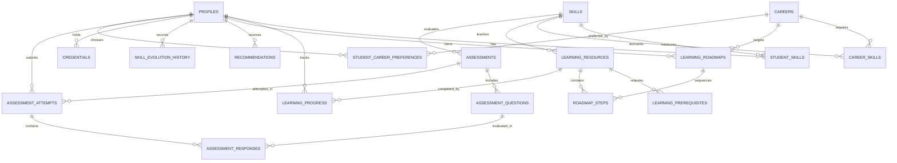

# SmartEvolve AI — Database Architecture & Schema Specification

## 1. Entity-Relationship Overview

The database is built on **Supabase PostgreSQL** with strict normalization, cryptographic UUID primary keys (`gen_random_uuid()`), and Row Level Security (RLS).

---

## 2. Table Specifications (19 Tables)

### 1. `profiles`
Links directly to Supabase Auth `auth.users(id)`.
- `id` (UUID, PRIMARY KEY): References `auth.users(id)`
- `full_name` (VARCHAR(255), NOT NULL)
- `education_level` (VARCHAR(100))
- `institution` (VARCHAR(255))
- `branch` (VARCHAR(150))
- `graduation_year` (INTEGER)
- `interests` (JSONB)
- `onboarding_completed` (BOOLEAN, DEFAULT FALSE)
- `created_at` (TIMESTAMPTZ), `updated_at` (TIMESTAMPTZ)

### 2. `skills`
- `id` (UUID, PRIMARY KEY)
- `name` (VARCHAR(100), UNIQUE, NOT NULL)
- `category` (VARCHAR(100), NOT NULL)
- `description` (TEXT)
- `created_at` (TIMESTAMPTZ)

### 3. `student_skills`
- `id` (UUID, PRIMARY KEY)
- `student_id` (UUID, FK -> `profiles.id`)
- `skill_id` (UUID, FK -> `skills.id`)
- `proficiency` (NUMERIC(5,2), CHECK 0-100)
- `confidence` (NUMERIC(5,2), CHECK 0-1.0)
- `evidence_type` (VARCHAR(50)): `SELF_REPORTED`, `ASSESSMENT`, `PROJECT`, `VERIFIED_CREDENTIAL`
- `last_assessed_at` (TIMESTAMPTZ)
- *Constraint*: `UNIQUE(student_id, skill_id)`

### 4. `careers`
- `id` (UUID, PRIMARY KEY)
- `name` (VARCHAR(150), UNIQUE, NOT NULL)
- `description` (TEXT, NOT NULL)
- `category` (VARCHAR(100), NOT NULL)
- `active` (BOOLEAN, DEFAULT TRUE)

### 5. `career_skills`
- `id` (UUID, PRIMARY KEY)
- `career_id` (UUID, FK -> `careers.id`)
- `skill_id` (UUID, FK -> `skills.id`)
- `required_proficiency` (NUMERIC(5,2))
- `importance_weight` (NUMERIC(5,2))
- `prerequisite_skill_id` (UUID, NULLABLE, FK -> `skills.id`)
- *Constraint*: `UNIQUE(career_id, skill_id)`

### 6. `learning_resources`
- `id` (UUID, PRIMARY KEY)
- `title` (VARCHAR(255), NOT NULL)
- `description` (TEXT)
- `skill_id` (UUID, FK -> `skills.id`)
- `difficulty` (VARCHAR(50)): `BEGINNER`, `INTERMEDIATE`, `ADVANCED`
- `content_type` (VARCHAR(50)): `ARTICLE`, `VIDEO`, `INTERACTIVE`, `PROJECT`
- `content_body` (TEXT)
- `external_url` (VARCHAR(500))
- `estimated_minutes` (INTEGER)
- `active` (BOOLEAN, DEFAULT TRUE)

### 7. `learning_prerequisites`
- `id` (UUID, PRIMARY KEY)
- `resource_id` (UUID, FK -> `learning_resources.id`)
- `prerequisite_resource_id` (UUID, FK -> `learning_resources.id`)
- *Constraints*: `UNIQUE(resource_id, prerequisite_resource_id)`, `CHECK(resource_id <> prerequisite_resource_id)`

### 8. `assessments`
- `id` (UUID, PRIMARY KEY)
- `title` (VARCHAR(255), NOT NULL)
- `skill_id` (UUID, FK -> `skills.id`)
- `difficulty` (VARCHAR(50))
- `assessment_type` (VARCHAR(50)): `DIAGNOSTIC`, `QUIZ`, `MILESTONE`
- `active` (BOOLEAN)

### 9. `assessment_questions`
- `id` (UUID, PRIMARY KEY)
- `assessment_id` (UUID, FK -> `assessments.id`)
- `question_text` (TEXT, NOT NULL)
- `question_type` (VARCHAR(50), DEFAULT 'MULTIPLE_CHOICE')
- `options` (JSONB): `[{"id":"A","text":"..."},{"id":"B","text":"..."}]`
- `correct_answer` (VARCHAR(255), NOT NULL) — protected on backend, never exposed before submission!
- `explanation` (TEXT)
- `marks` (INTEGER)
- `order_index` (INTEGER)

### 10. `assessment_attempts`
- `id` (UUID, PRIMARY KEY)
- `student_id` (UUID, FK -> `profiles.id`)
- `assessment_id` (UUID, FK -> `assessments.id`)
- `score` (NUMERIC(5,2))
- `maximum_score` (NUMERIC(5,2))
- `percentage` (NUMERIC(5,2))
- `attempt_number` (INTEGER)
- `time_taken_seconds` (INTEGER)
- `submitted_at` (TIMESTAMPTZ)

### 11. `assessment_responses`
- `id` (UUID, PRIMARY KEY)
- `attempt_id` (UUID, FK -> `assessment_attempts.id`)
- `question_id` (UUID, FK -> `assessment_questions.id`)
- `submitted_answer` (VARCHAR(255))
- `awarded_marks` (NUMERIC(5,2))

### 12. `learning_progress`
- `id` (UUID, PRIMARY KEY)
- `student_id` (UUID, FK -> `profiles.id`)
- `resource_id` (UUID, FK -> `learning_resources.id`)
- `status` (VARCHAR(50)): `NOT_STARTED`, `IN_PROGRESS`, `COMPLETED`
- `progress_percentage` (NUMERIC(5,2))
- *Constraint*: `UNIQUE(student_id, resource_id)`

### 13. `learning_roadmaps`
- `id` (UUID, PRIMARY KEY)
- `student_id` (UUID, FK -> `profiles.id`)
- `career_id` (UUID, FK -> `careers.id`)
- `version` (INTEGER)
- `status` (VARCHAR(50)): `ACTIVE`, `ARCHIVED`, `COMPLETED`

### 14. `roadmap_steps`
- `id` (UUID, PRIMARY KEY)
- `roadmap_id` (UUID, FK -> `learning_roadmaps.id`)
- `resource_id` (UUID, FK -> `learning_resources.id`)
- `skill_id` (UUID, FK -> `skills.id`)
- `sequence_number` (INTEGER)
- `priority` (VARCHAR(50)): `CRITICAL`, `HIGH`, `MEDIUM`, `LOW`
- `reason` (TEXT)
- `status` (VARCHAR(50)): `LOCKED`, `AVAILABLE`, `IN_PROGRESS`, `COMPLETED`

### 15. `recommendations`
- `id` (UUID, PRIMARY KEY)
- `student_id` (UUID, FK -> `profiles.id`)
- `skill_id` (UUID, FK -> `skills.id`)
- `resource_id` (UUID, FK -> `learning_resources.id`)
- `career_id` (UUID, FK -> `careers.id`)
- `recommendation_type` (VARCHAR(50))
- `priority` (VARCHAR(50))
- `reason` (TEXT)
- `status` (VARCHAR(50)): `ACTIVE`, `DISMISSED`

### 16. `skill_evolution_history`
- `id` (UUID, PRIMARY KEY)
- `student_id` (UUID, FK -> `profiles.id`)
- `skill_id` (UUID, FK -> `skills.id`)
- `previous_proficiency` (NUMERIC(5,2))
- `new_proficiency` (NUMERIC(5,2))
- `change_reason` (TEXT)
- `evidence_type` (VARCHAR(50))
- `evidence_reference` (VARCHAR(255))
- `profile_version` (INTEGER)

### 17. `credentials`
- `id` (UUID, PRIMARY KEY)
- `student_id` (UUID, FK -> `profiles.id`)
- `credential_type` (VARCHAR(100)): `SKILL_MASTERY`, `CAREER_READY`
- `skill_id` (UUID, FK -> `skills.id`)
- `achievement_title` (VARCHAR(255))
- `achievement_data_hash` (VARCHAR(66)): `0x...` SHA-256 / Keccak-256 hash
- `issuer_address` (VARCHAR(42)): Ethereum address
- `network_id` (VARCHAR(50))
- `contract_address` (VARCHAR(42))
- `transaction_hash` (VARCHAR(66)): EVM on-chain transaction hash
- `block_number` (BIGINT)
- `status` (VARCHAR(50)): `PENDING`, `CONFIRMED`, `FAILED`, `REVOKED`
- `issued_at` (TIMESTAMPTZ), `verified_at` (TIMESTAMPTZ)

### 18. `student_career_preferences`
- `id` (UUID, PRIMARY KEY)
- `student_id` (UUID, FK -> `profiles.id`)
- `career_id` (UUID, FK -> `careers.id`)
- `preference_rank` (INTEGER)
- *Constraint*: `UNIQUE(student_id, career_id)`

### 19. `audit_events`
- `id` (UUID, PRIMARY KEY)
- `actor_id` (UUID)
- `event_type` (VARCHAR(100))
- `resource_type` (VARCHAR(100))
- `resource_id` (UUID)
- `metadata` (JSONB)
- `created_at` (TIMESTAMPTZ)

---

## 3. Row Level Security (RLS) Summary

Every student-specific table has RLS enabled with `USING (auth.uid() = student_id)` or `USING (auth.uid() = id)`:
- A student can only view and mutate their own profile, learning progress, attempts, roadmaps, and career preferences.
- Catalog tables (`skills`, `careers`, `career_skills`, `learning_resources`, `learning_prerequisites`, `assessments`) are open for authenticated SELECT queries.
- `assessment_questions` correct answers are evaluated exclusively via the Spring Boot backend service, preventing client-side inspection.
